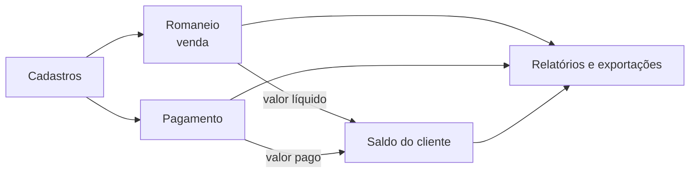

# Romaneios

Sistema web da Madeireira JD para registrar vendas de madeira (romaneios), pagamentos de clientes e saldos, com relatórios em tela, Excel e PDF.

[Arquitetura](docs/arquitetura.md) · [Regras de negócio](docs/regras-de-negocio.md) · [Operação](docs/operacao.md) · [Roteiro](ROADMAP.md)

## O que faz

- **Cadastros** de clientes (CPF/CNPJ opcional e validado), tipos de madeira com preço normal e preço com frete, motoristas, romaneiadores e operadores.
- **Romaneios** com uma ou mais madeiras, em duas modalidades:
  - *Simples*: o operador informa o m³ de cada madeira.
  - *Detalhado*: o operador registra cada tora (comprimento, rôdo e descontos), e o m³ é calculado e somado.

  O preço vem do tipo de madeira conforme o romaneio seja normal ou com frete; os totais (m³, valor bruto e valor líquido) são calculados pelo sistema.
- **Pagamentos** de clientes (dinheiro, PIX, transferência, cheque, depósito, outros).
- **Saldo do cliente** sempre calculado a partir das vendas e dos pagamentos, sem ajuste manual: negativo quando o cliente deve, positivo quando tem crédito.
- **Dashboard** do mês: m³ vendidos, faturamento, número de romaneios, total a receber, maiores devedores e maiores compradores.
- **Relatórios** com filtro por período e exportação em Excel e PDF: Ficha de Romaneios, Ficha de Madeiras, Fluxo Financeiro (com saldo corrido por cliente) e Saldo de Clientes. Cada romaneio também sai em PDF para impressão.
- **Acesso** por login com usuário ou e-mail e recuperação de senha por e-mail.



## Estado

**2026-11-19:** em produção desde 2026-01-31, com deploy automático a cada push na `main`. Há débitos técnicos prioritários, entre eles a perda de alterações na edição de romaneios detalhados, a falta de backup automático e brechas de acesso. Detalhes no [roteiro](ROADMAP.md).

## Tecnologias

| Camada | Tecnologia | Versão |
|---|---|---|
| Linguagem | Python | 3.12 |
| Framework | Django | 4.2.27 |
| Banco de dados | PostgreSQL (driver `psycopg2-binary`) | 2.9.11 (driver) |
| Servidor de aplicação | Gunicorn, atrás de Nginx (fora do `requirements.txt`) | — |
| Interface | Bootstrap, Font Awesome, jQuery, Select2 (via CDN) | 5.3.0, 6.4.0, 3.7.0, 4.1.0-rc.0 |
| Excel | openpyxl | 3.1.5 |
| PDF | WeasyPrint | 62.3 |
| Configuração | python-dotenv | 1.2.1 |

Versões das bibliotecas Python em [`requirements.txt`](requirements.txt).

## Início rápido

Pré-requisitos: Python 3.12 e PostgreSQL. Para os PDFs, as bibliotecas nativas do WeasyPrint (lista em [desenvolvimento](docs/desenvolvimento.md#ambiente)).

```bash
git clone https://github.com/Frraz/Romaneios.git
cd Romaneios
python3.12 -m venv venv
source venv/bin/activate
pip install -r requirements.txt
cp .env.example .env            # ajuste DB_* e SECRET_KEY
python manage.py migrate
python manage.py createsuperuser
python manage.py runserver
```

A aplicação fica em `http://127.0.0.1:8000/`. Atenção: a porta padrão do banco no projeto é **5433**.

Testes (usam SQLite em memória, sem PostgreSQL):

```bash
DJANGO_SETTINGS_MODULE=config.settings_test python manage.py test -v 2
```

O estado atual da suíte está em [desenvolvimento](docs/desenvolvimento.md#estado-da-suíte).

## Configuração

Variáveis lidas do arquivo `.env` na raiz. A lista completa, com exemplos, está em [`.env.example`](.env.example).

| Variável | Para que serve | Exemplo |
|---|---|---|
| `SECRET_KEY` | Chave criptográfica do Django | cadeia longa e aleatória |
| `DEBUG` | Modo de desenvolvimento. `False` em produção liga HTTPS obrigatório, cookies seguros e HSTS | `True` |
| `ALLOWED_HOSTS` | Domínios aceitos | `app.exemplo.com.br` |
| `CSRF_TRUSTED_ORIGINS` | Origens aceitas nos formulários (com `https://`) | `https://app.exemplo.com.br` |
| `SITE_DOMAIN`, `SITE_PROTOCOL` | Montam o link do e-mail de redefinição de senha | `app.exemplo.com.br`, `https` |
| `SECURE_PROXY_SSL_HEADER` | Cabeçalho do proxy que indica HTTPS | `HTTP_X_FORWARDED_PROTO,https` |
| `DB_NAME`, `DB_USER`, `DB_PASSWORD`, `DB_HOST`, `DB_PORT` | Conexão com o PostgreSQL | `romaneios`, `romaneios`, …, `localhost`, `5433` |
| `EMAIL_BACKEND`, `EMAIL_HOST`, `EMAIL_PORT`, `EMAIL_HOST_USER`, `EMAIL_HOST_PASSWORD` | Envio de e-mail (SMTP) | `smtp.exemplo.com.br`, `587` |
| `DEFAULT_FROM_EMAIL` | Remetente dos e-mails | `Romaneios <no-reply@exemplo.com.br>` |

## Estrutura

| Pasta | Conteúdo |
|---|---|
| `apps/cadastros/` | Clientes, tipos de madeira, motoristas, romaneiadores, operadores |
| `apps/romaneio/` | Romaneios, itens e unidades; cálculo dos totais |
| `apps/financeiro/` | Pagamentos |
| `apps/relatorios/` | Dashboard, relatórios e exportações |
| `apps/core/` | Login por usuário ou e-mail e redefinição de senha |
| `apps/tests/` | Fábricas e testes do projeto |
| `config/` | Configurações (`settings.py`, `settings_test.py`), rotas e WSGI |
| `templates/` | Layout base, login e redefinição de senha |
| `static/` | Folha de estilos |
| `media/` | Logo da tela de login |
| `.github/workflows/` | Deploy automático |
| `docs/` | Documentação |

## Documentação

| Se você quer… | Leia |
|---|---|
| Entender como o sistema é organizado | [Arquitetura](docs/arquitetura.md) |
| Conhecer termos, fórmulas e validações | [Regras de negócio](docs/regras-de-negocio.md) |
| Saber o que cada relatório mostra e exporta | [Relatórios](docs/relatorios.md) |
| Desenvolver e rodar os testes | [Desenvolvimento](docs/desenvolvimento.md) |
| Publicar, reverter e fazer backup | [Operação](docs/operacao.md) |
| Ver o que falta e os defeitos conhecidos | [Roteiro](ROADMAP.md) |
| Saber o que mudou | [Registro de mudanças](CHANGELOG.md) |
| Ver o índice completo | [docs/](docs/README.md) |

## Licença

Código proprietário, sem licença de uso definida (a confirmar com o autor).
