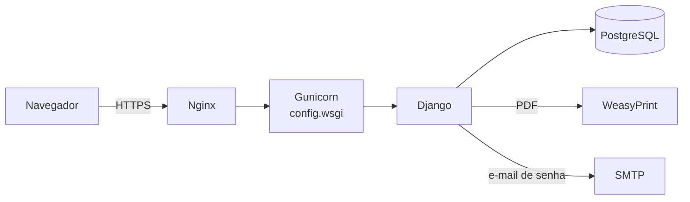
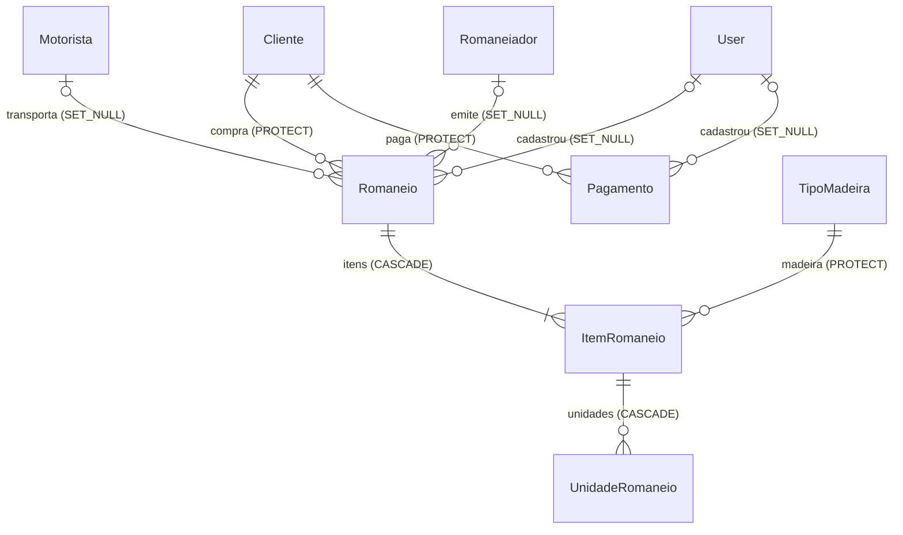
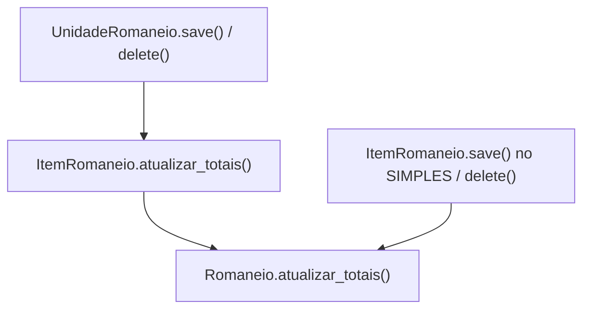

# Arquitetura

Como o sistema é organizado: apps, rotas, modelo de dados, cálculo dos totais e autenticação. As regras de cálculo em si estão em [regras-de-negocio.md](regras-de-negocio.md); os relatórios, em [relatorios.md](relatorios.md).

## Visão geral

Aplicação Django monolítica, renderizada no servidor: Class-Based Views, templates Django com Bootstrap 5 e um pouco de jQuery para os formulários. Não há API pública nem front-end separado. O único endpoint JSON é o de preço da madeira, usado pelo formulário de romaneio.

O que está fora do repositório (Nginx, unidade systemd, banco) está descrito em [operacao.md](operacao.md).

## Apps

| App | Responsabilidade | Modelos |
|---|---|---|
| `apps/cadastros` | Clientes, tipos de madeira, motoristas, romaneiadores e operadores (usuários). Comando `mock_dados` | `Cliente`, `TipoMadeira`, `Motorista`, `Romaneiador` |
| `apps/romaneio` | Romaneio (venda), itens e unidades; endpoint de preço | `Romaneio`, `ItemRomaneio`, `UnidadeRomaneio` |
| `apps/financeiro` | Pagamentos de clientes | `Pagamento` |
| `apps/relatorios` | Dashboard, quatro relatórios e exportações. Montado na raiz do site | — |
| `apps/core` | Backend de login por usuário ou e-mail, view de redefinição de senha. Também contém um dashboard antigo e dois modelos sem uso (DT-16) | `ConfiguracaoGeral` (sem uso), `BaseModel` (abstrato, sem uso) |
| `apps/tests` | Fábricas de objetos para testes e testes de projeto (URLs, settings, dependências) | — |

Usuários são o `User` padrão do Django; não há modelo de usuário próprio.

## Configuração

| Arquivo | Papel |
|---|---|
| `config/settings.py` | Configuração única de desenvolvimento e produção. Lê o `.env` da raiz com `python-dotenv`. Banco PostgreSQL. Com `DEBUG=False`, liga cookies seguros, redirecionamento para HTTPS e HSTS |
| `config/settings_test.py` | Herda tudo e troca por SQLite em memória, hasher MD5 (rápido), e-mail em memória e HTTPS desligado |
| `config/urls.py` | Rotas de autenticação e inclusão das apps |
| `config/wsgi.py` | Ponto de entrada do Gunicorn |

Fuso `America/Sao_Paulo`, idioma `pt-br`, separador de milhar `.` e decimal `,`. As variáveis de ambiente estão no [README](../README.md#configuração) e em `.env.example`.

## Rotas

Todas exigem login, exceto as de autenticação e `/core/` (DT-03).

### Autenticação (`config/urls.py`)

| Rota | Nome | Função |
|---|---|---|
| `/accounts/login/` | `login` | Login por usuário ou e-mail |
| `/accounts/logout/` | `logout` | Logout |
| `/accounts/password_reset/` | `password_reset` | Pede o e-mail e envia o link |
| `/accounts/password_reset/done/` | `password_reset_done` | Confirmação de envio |
| `/accounts/reset/<uidb64>/<token>/` | `password_reset_confirm` | Nova senha |
| `/accounts/reset/done/` | `password_reset_complete` | Fim do fluxo |
| `/admin/` | — | Admin do Django, sem nenhum modelo registrado (DT-17) |

### Relatórios (`relatorios:`, raiz do site)

| Rota | Nome |
|---|---|
| `/` | `dashboard` |
| `/ficha-romaneios/` | `ficha_romaneios` |
| `/ficha-romaneios/export/` | `ficha_romaneios_export` (CSV) |
| `/ficha-romaneios/export/excel/` | `ficha_romaneios_export_excel` |
| `/ficha-romaneios/export/pdf/` | `ficha_romaneios_export_pdf` |
| `/romaneios/<romaneio_id>/export/pdf/` | `romaneio_export_pdf` |
| `/romaneios/<romaneio_id>/export/excel/` | `romaneio_export_excel` |
| `/ficha-madeiras/` | `ficha_madeiras` |
| `/ficha-madeiras/export/excel/` | `ficha_madeiras_export_excel` |
| `/ficha-madeiras/export/pdf/` | `ficha_madeiras_export_pdf` |
| `/fluxo-financeiro/` | `fluxo_financeiro` |
| `/fluxo-financeiro/export/excel/` | `fluxo_financeiro_export_excel` |
| `/fluxo-financeiro/export/pdf/` | `fluxo_financeiro_export_pdf` |
| `/saldo-clientes/` | `saldo_clientes` |
| `/saldo-clientes/export/excel/` | `saldo_clientes_export_excel` |
| `/saldo-clientes/export/pdf/` | `saldo_clientes_export_pdf` |

### Cadastros (`cadastros:`, prefixo `/cadastros/`)

Cada um dos quatro cadastros tem lista, novo, editar e excluir:

| Recurso | Lista | Nomes das rotas |
|---|---|---|
| Clientes | `clientes/` | `cliente_list`, `cliente_create`, `cliente_update`, `cliente_delete` |
| Tipos de madeira | `tipos_madeira/` | `tipo_madeira_list`, `_create`, `_update`, `_delete` |
| Motoristas | `motoristas/` | `motorista_list`, `_create`, `_update`, `_delete` |
| Romaneiadores | `romaneiadores/` | `romaneiador_list`, `_create`, `_update`, `_delete` |
| Operadores | `usuarios/` | `usuario_list`, `usuario_create`, `usuario_update` (sem exclusão; exige staff) |

Padrão das URLs: `<recurso>/`, `<recurso>/novo/`, `<recurso>/<pk>/editar/`, `<recurso>/<pk>/excluir/`.

### Romaneios (`romaneio:`, prefixo `/romaneio/`)

| Rota | Nome |
|---|---|
| `/romaneio/` | `romaneio_list` |
| `/romaneio/novo/` | `romaneio_create` |
| `/romaneio/<pk>/` | `romaneio_detail` |
| `/romaneio/<pk>/editar/` | `romaneio_update` |
| `/romaneio/excluir/<pk>/` | `romaneio_delete` |
| `/romaneio/api/preco-madeira/?tipo_madeira_id=&tipo_romaneio=` | `get_preco_madeira` (JSON `{"success": true, "preco": 460.0}`) |

### Financeiro (`financeiro:`, prefixo `/financeiro/`)

`pagamentos/`, `pagamentos/novo/`, `pagamentos/<pk>/editar/`, `pagamentos/<pk>/excluir/`, com os nomes `pagamento_list`, `pagamento_create`, `pagamento_update` e `pagamento_delete`.

### Core (`core:`, prefixo `/core/`)

`/core/` (`dashboard`): versão antiga e simplificada do dashboard, sem login e sem link no menu (DT-03).

## Modelo de dados

Pontos que o diagrama não mostra:

- `Romaneio.numero_romaneio` é texto, único e indexado.
- `Romaneio.m3_total`, `valor_bruto` e `valor_total` e `ItemRomaneio.valor_total` têm `editable=False`: são sempre derivados.
- O saldo do cliente não é um campo: é a propriedade `Cliente.saldo_atual`.
- `Pagamento` tem índice composto em `(data_pagamento, cliente)`.

### Histórico do modelo de romaneio

Até 2026-02-05 havia dois modelos separados, `Romaneio` e `RomaneioDetalhado`. A migração de dados `apps/romaneio/migrations/0005_migrar_romaneio_detalhado_para_unico.py` copiou os detalhados para o modelo único com `modalidade="DETALHADO"`, e a `0006` removeu os modelos antigos. Em 2026-02-06 (`0007`), as medidas saíram do item e passaram para `UnidadeRomaneio`. Não reverta essas migrações em produção.

## Cascata dos totais

Os totais são mantidos pelos próprios modelos (`apps/romaneio/models.py`), sem signals:

- No `SIMPLES`, `ItemRomaneio.save()` calcula o valor do item e atualiza o romaneio.
- No `DETALHADO`, cada unidade salva recalcula o item (soma das unidades) e o romaneio.
- As views de criação e edição ainda recalculam tudo no fim (`_recalcular_totais_apos_salvar`), dentro de uma transação (`transaction.atomic`).
- `QuerySet.update()`, `bulk_create()` e exclusões em massa pulam esses métodos e deixam os totais errados. Use o `save()`/`delete()` de cada objeto.

## Formulário de romaneio

`apps/romaneio/views.py` e `apps/romaneio/forms.py` montam três níveis de formulário: o romaneio, um formset de itens (`ItemRomaneioFormSet`) e, para cada item, um formset de unidades com prefixo `unidades-<índice do item>`. O POST sempre traz o formulário de gerenciamento das unidades, mesmo no `SIMPLES`.

O JavaScript de `romaneio_form.html` adiciona e remove itens e unidades, busca o preço da madeira, calcula o m³ das unidades e os totais na tela e alterna os campos entre `SIMPLES` e `DETALHADO`. O servidor recalcula tudo ao salvar.

Na edição, as unidades são associadas aos itens pela posição na lista de itens **alterados** devolvida por `formset.save()`. Quando um item anterior não muda, as unidades dos itens seguintes vão para o prefixo errado e as alterações delas se perdem sem aviso (DT-01).

## Autenticação e permissões

- `AUTHENTICATION_BACKENDS`: `apps.core.auth_backends.UsernameOrEmailBackend` (usuário ou e-mail, sem diferenciar maiúsculas) e o `ModelBackend` padrão.
- Views usam `LoginRequiredMixin` ou `@login_required`. As de operadores usam também o `StaffRequiredMixin` (`apps/cadastros/views.py`), que redireciona ao dashboard com mensagem em vez de responder 403.
- O link do e-mail de redefinição usa `SITE_PROTOCOL` e `SITE_DOMAIN` do `.env`, e não o host da requisição (`apps/core/auth_views.py`). Isso evita links com o host interno quando o sistema roda atrás de proxy.
- Os templates de login, logout e redefinição ficam em `templates/registration/`.

## Front-end

Templates em `templates/` (base, login e redefinição) e em `apps/<app>/templates/<app>/`. Bibliotecas por CDN, sem etapa de build. Detalhes em [design.md](design.md).
